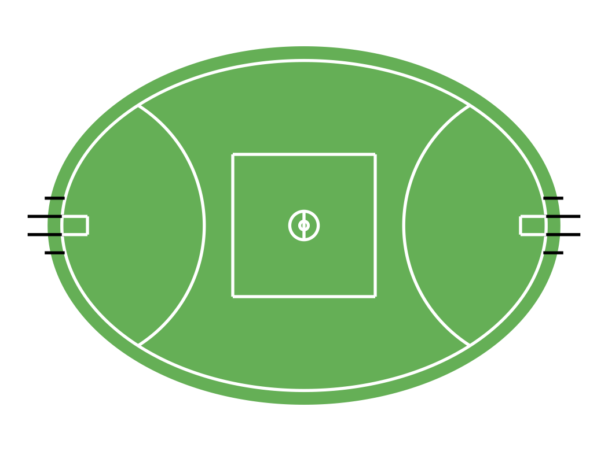

# PlotAFLField

An R function that draws an AFL field to scale with `ggplot2`, sized to any venue. It returns a ggplot object, so you can layer your own data (kicks, marks, shots at goal) on top. [FootyStatsApp](https://github.com/CooperDenny/FootyStatsApp) uses it for every field visual.

## Usage

```r
source("https://raw.githubusercontent.com/CooperDenny/PlotAFLField/main/plot_afl_field.R")

afl_field(venue_length = 160, venue_width = 140, venue_arclength = 50)

# Add your own layers in field coordinates (metres, origin at the centre bounce)
afl_field(170, 116) +
  geom_point(data = shots, aes(x = x, y = y, colour = result))
```

| Argument | Default | Meaning |
|---|---|---|
| `venue_length` | `160` | Boundary-to-boundary length, goal to goal (m) |
| `venue_width` | `140` | Boundary-to-boundary width (m) |
| `venue_arclength` | `50` | Radius of the arcs, measured from the centre of each goal line (m) |

## What is drawn

All markings are to the dimensions in the AFL Laws of the Game:

- Elliptical boundary line, with 5 m of grass outside it
- 50 m × 50 m centre square
- Centre circles of 3 m and 10 m diameter, with the centre line
- Goal squares 9 m deep and 6.4 m wide
- Goal and behind posts, 6.4 m apart
- 50 m arcs that meet the boundary line exactly. The crossing point is solved from the circle–ellipse intersection (`afl_arc_angle()`), so it stays exact for long, wide or perfectly round grounds.

`afl_field()` stops with a clear message if the arc radius can't reach the boundary of the ground you've described.

## Requirements

`ggplot2` (3.4.0 or later) only.

## Contents
- `plot_afl_field.R`: the `afl_field()` function and its geometry helpers
- `PlotAFLField.Rproj`: R project file
- `images/`: example output

## Example Plots
`afl_field(venue_length = 160, venue_width = 140, venue_arclength = 50)`


`afl_field(venue_length = 170, venue_width = 116, venue_arclength = 50)`

