# PlotAFLField

R functions that draw an AFL field to scale with `ggplot2`, sized to any venue, plus the analysis views that sit on top of it: half-field shot maps, scoring-angle contours, zone maps and heatmaps. Every function returns a ggplot object, so you can layer your own data (kicks, marks, shots at goal) on top. [FootyStatsApp](https://github.com/CooperDenny/FootyStatsApp) uses it for every field visual.

## Usage

```r
source("https://raw.githubusercontent.com/CooperDenny/PlotAFLField/main/plot_afl_field.R")

afl_field(venue_length = 160, venue_width = 140, venue_arclength = 50)

# Add your own layers in field coordinates (metres, origin at the centre bounce)
afl_field(170, 116) +
  geom_point(data = shots, aes(x = x, y = y, colour = result))
```

Coordinates are metres with the origin at the centre bounce and x running goal to goal. The analysis functions assume the team of interest attacks towards **+x** (the right-hand goal), so flip `x` and `y` for the quarters a team kicks the other way.

### Vertical grounds

Every function that draws a ground (`afl_field()`, `afl_half_field()`, `afl_zone_map()`, `afl_heatmap()`) takes `vertical = TRUE` to turn the ground so it runs up the page, with the +x goal at the top. Your data keeps the same x and y. The ground is rotated a quarter turn, not mirrored, so "left" stays the attacking team's left. Metres stay square because the panel's aspect ratio is fixed to the ground's dimensions, whatever layers you add. Layers such as `afl_angle_contours()` and your own `geom_point()`s rotate with the ground automatically.

```r
afl_field(160, 140, 50, vertical = TRUE) +
  geom_point(data = shots, aes(x = x, y = y))   # same x/y as on a horizontal ground
```

Don't add `coord_flip()` or `coord_fixed()` on top of a vertical ground; it already has its coordinate system.

| Function | What it draws |
|---|---|
| `afl_field(venue_length, venue_width, venue_arclength, vertical = FALSE)` | The whole ground |
| `afl_half_field(..., from = 0, end = "right", vertical = FALSE)` | One end of the ground. `from` is where the view starts (m from centre); `venue_length/2 - venue_arclength - 3` frames the 50 m arc. With `vertical = TRUE` the goal is at the top: a wide, short panel |
| `afl_angle_contours(venue_length, venue_width, angles = c(10, 15, 20, 30))` | Layer: lines of equal scoring angle |
| `afl_zones(..., corridor_width = 50)` | Data frame of the nine zone polygons (3 thirds × 3 lanes), clipped to the boundary |
| `afl_zone_of(x, y, ..., corridor_width = 50)` | Which third, lane and zone each point is in |
| `afl_zone_map(data, ..., value = NULL, min_n = 1, vertical = FALSE)` | Zones shaded by share of events, or by the mean of `value` (e.g. an efficiency rate) |
| `afl_heatmap(data, ..., bandwidth = 8, vertical = FALSE)` | Smoothed density of event locations, clipped to the boundary |
| `afl_markings(venue_length, venue_width, venue_arclength)` | Layer: every marking, to redraw lines on top of your own fill layers |

The ground arguments are the same everywhere:

| Argument | Default | Meaning |
|---|---|---|
| `venue_length` | `160` | Boundary-to-boundary length, goal to goal (m) |
| `venue_width` | `140` | Boundary-to-boundary width (m) |
| `venue_arclength` | `50` | Radius of the arcs, measured from the centre of each goal line (m) |

## What is drawn

All markings are to the dimensions in the AFL Laws of the Game:

- Elliptical boundary line, with 5 m of grass outside it
- 50 m × 50 m centre square
- Centre circles of 3 m and 10 m diameter, with the centre line
- Goal squares 9 m deep and 6.4 m wide
- Goal and behind posts, 6.4 m apart
- 50 m arcs that meet the boundary line exactly. The crossing point is solved from the circle–ellipse intersection (`afl_arc_angle()`), so it stays exact for long, wide or perfectly round grounds.

`afl_field()` stops with a clear message if the arc radius can't reach the boundary of the ground you've described.

### Scoring-angle contours

Every point on one contour sees the 6.4 m goal mouth at the same angle. By the inscribed angle theorem those points lie on a circle through both goal posts, with radius `3.2 / sin(angle)` and its centre `3.2 / tan(angle)` in front of the goal line. So the contours are exact circle arcs, not interpolated, and each one crosses the centre line of the ground `3.2 × cot(angle / 2)` metres out (10° ≈ 36.6 m, 20° ≈ 18.1 m, 30° ≈ 11.9 m). Angle is not the whole story for goal kicking, since distance matters too, but it separates "bad position" from "bad kick".

### Zones

Thirds are the defensive 50, the midfield and the forward 50, bounded by the arcs. Lanes are the corridor and the boundary lane on each side; left and right are as seen by the team attacking +x. The corridor is an analytics convention, not a marking in the Laws, so its width is a parameter. The 50 m default lines it up with the centre square.

With one match of data, keep zones coarse. A team has roughly 150–250 kicks in a game, so even nine zones leave some with single-digit counts. Use `min_n` to leave those unshaded instead of showing a 100% rate from three kicks.

## Requirements

`ggplot2` (3.4.0 or later) only.

## Contents
- `plot_afl_field.R`: all functions and their geometry helpers
- `examples.R`: regenerates every image in `images/` (the event data is simulated)
- `PlotAFLField.Rproj`: R project file
- `images/`: example output

## Example Plots

All event data in these examples is simulated; see `examples.R`.

`afl_field(venue_length = 160, venue_width = 140, venue_arclength = 50)`
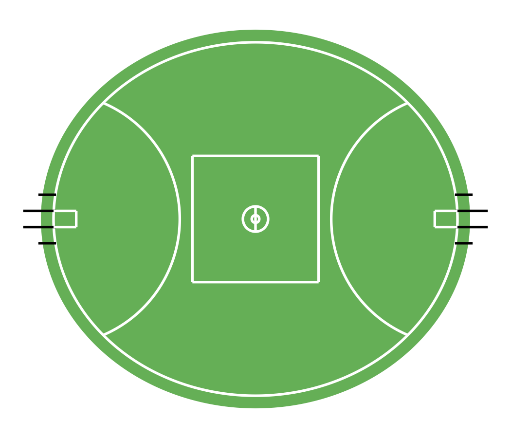

`afl_field(venue_length = 170, venue_width = 116, venue_arclength = 50)`


`afl_field(venue_length = 160, venue_width = 140, venue_arclength = 50, vertical = TRUE)`
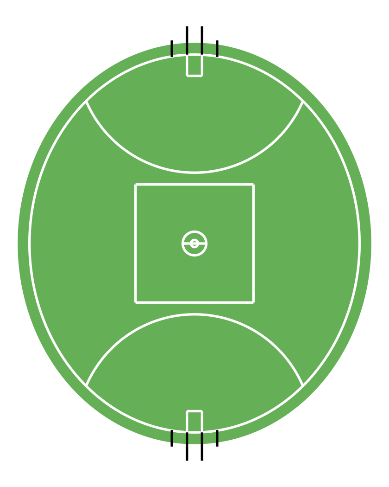

`afl_half_field(venue_length = 160, venue_width = 140, venue_arclength = 50)`
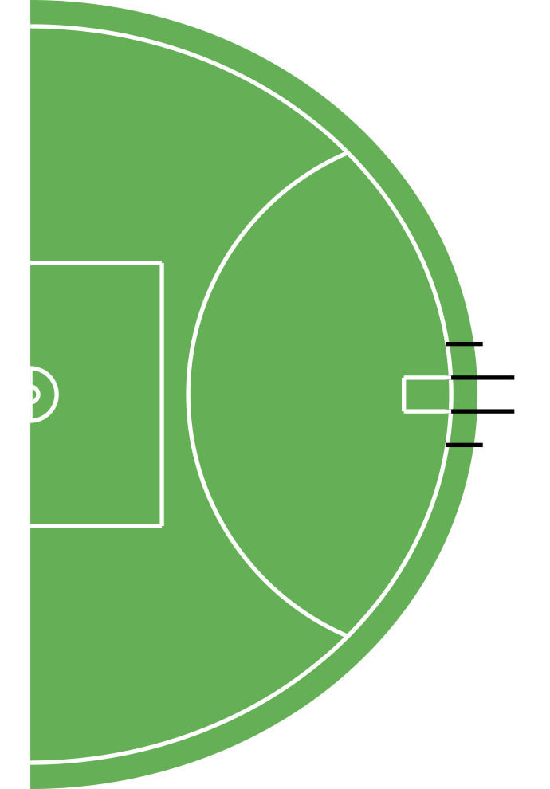

`afl_field(160, 140, 50) + afl_angle_contours(160, 140, angles = c(10, 20, 30), end = "both")`
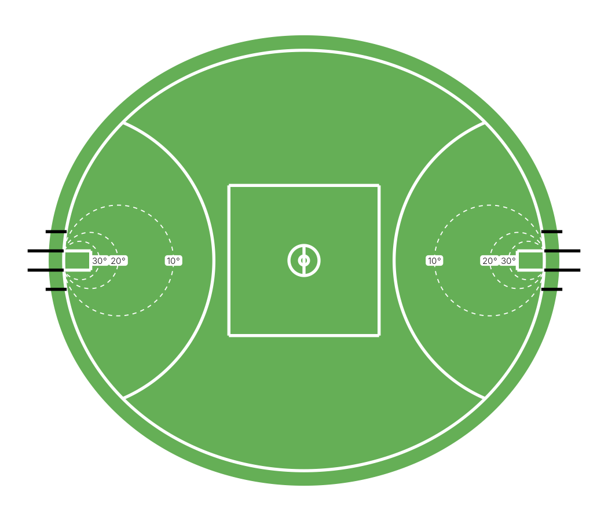

Shot map: `afl_half_field(160, 140, 50, from = 27) + afl_angle_contours(160, 140) + geom_point(data = shots, ...)`
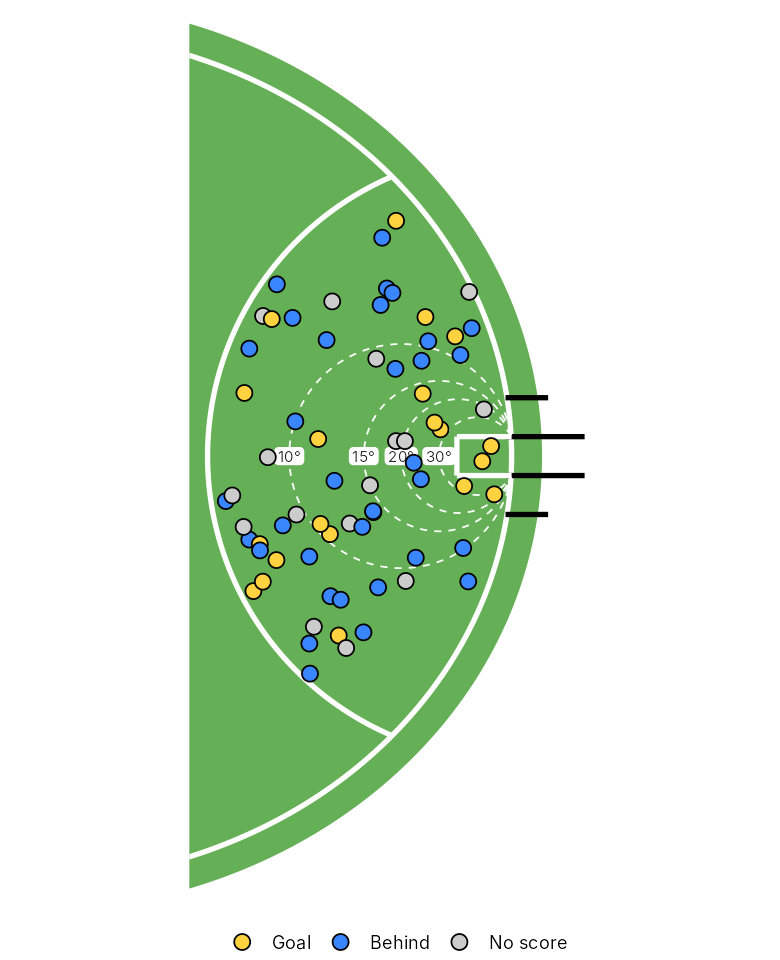

The same shots with `afl_half_field(160, 140, 50, from = 27, vertical = TRUE)`
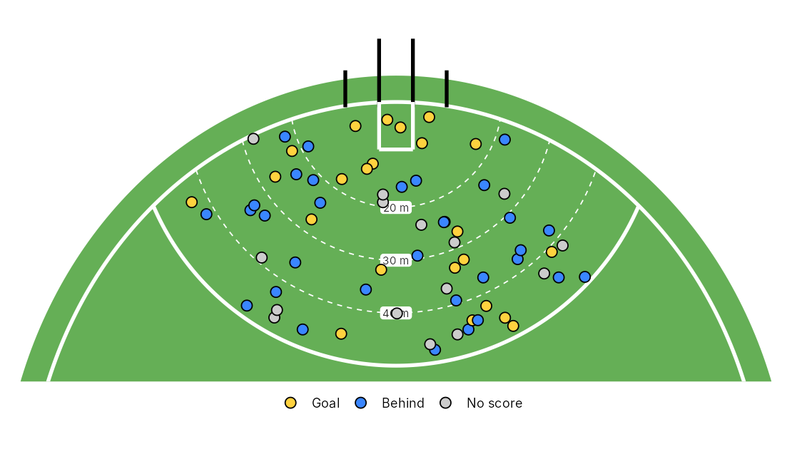

The nine zones from `afl_zones(160, 140, 50)`
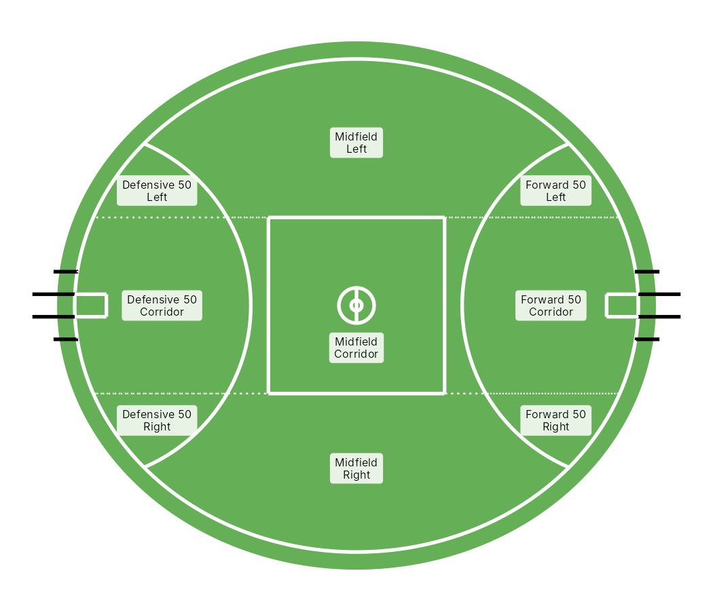

`afl_zone_map(possessions, 160, 140, 50)`
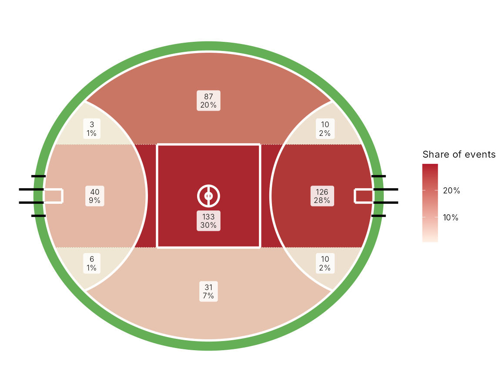

`afl_zone_map(kicks, 160, 140, 50, value = "effective", min_n = 8, legend_title = "Kick efficiency")`
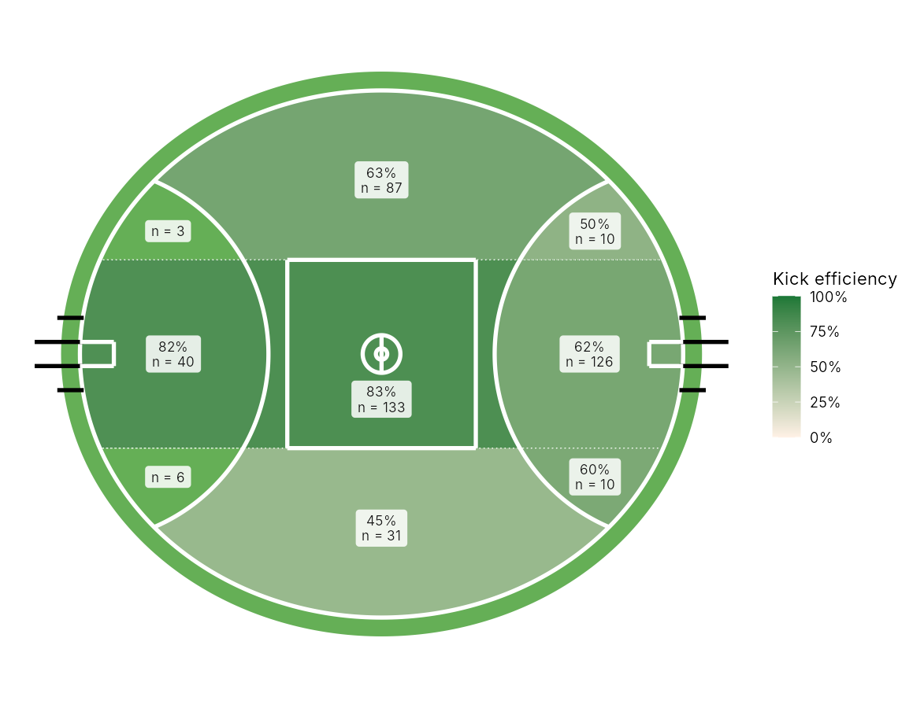

`afl_heatmap(possessions, 160, 140, 50)`
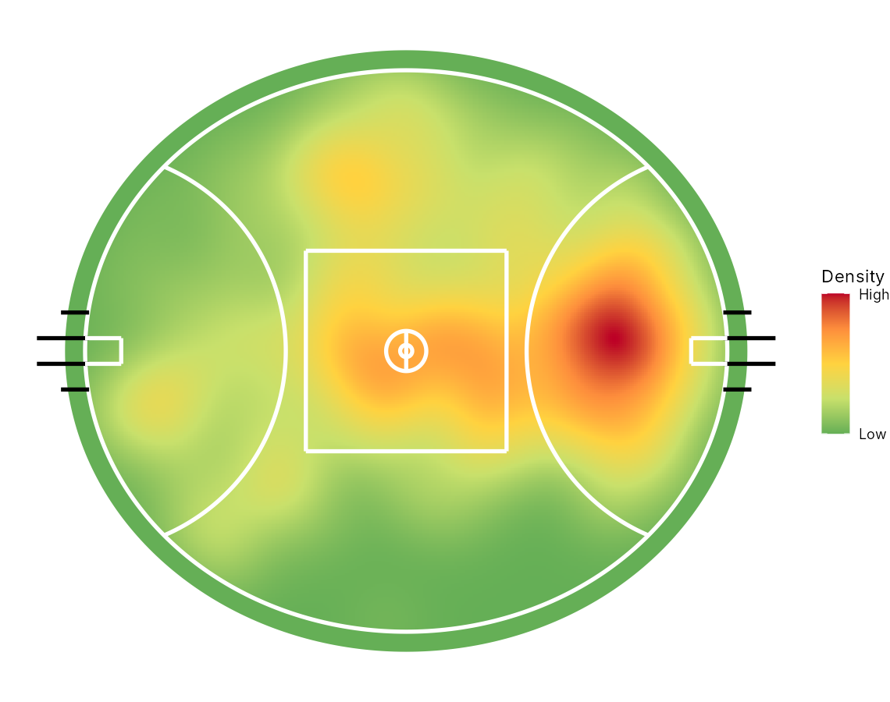

`afl_heatmap(possessions, 160, 140, 50, vertical = TRUE)`
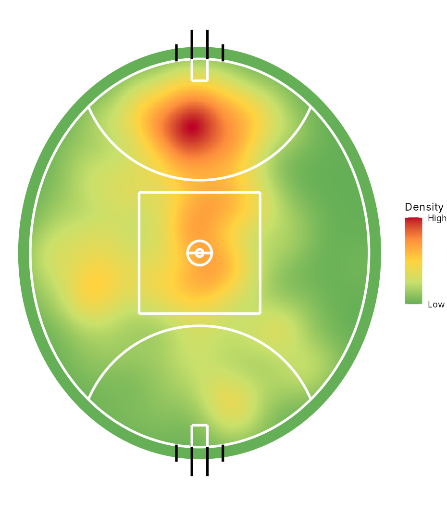
